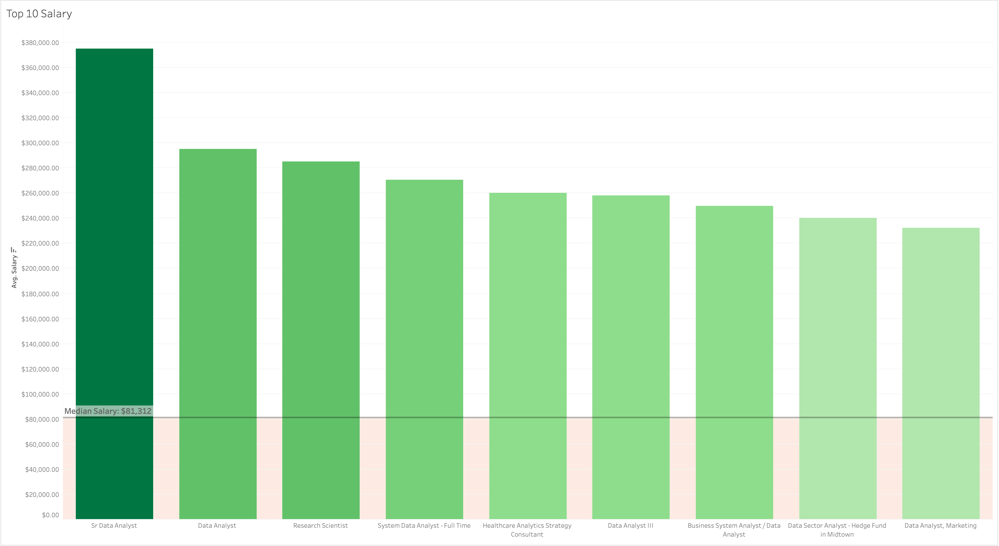
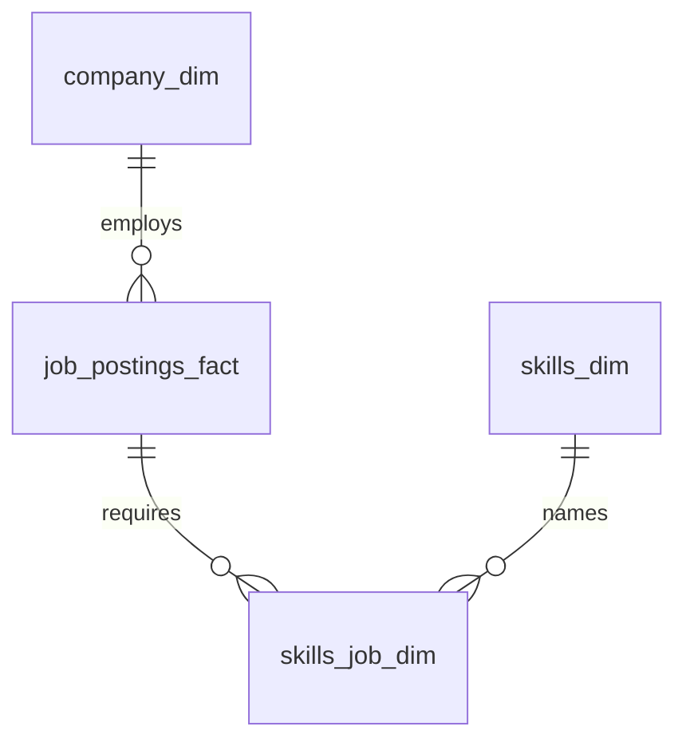
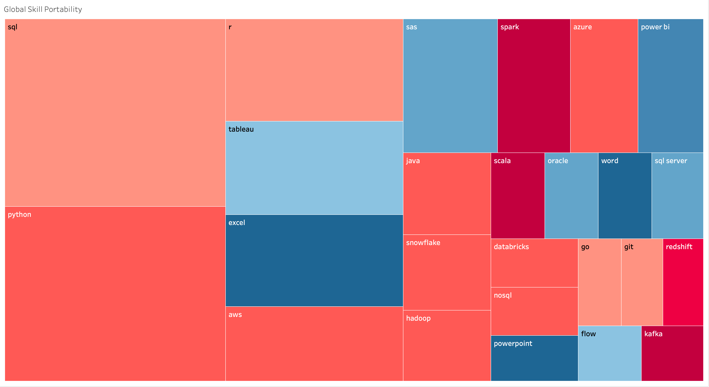

# Data Market Intelligence

Data Market Intelligence is a PostgreSQL analytics project with a Tableau analysis of a 2023 data-job-posting sample. I built a local fact/dimension schema with a many-to-many skills bridge, then wrote six queries about listed salary, skills, monthly posting volume, employer patterns, and cross-role demand. [Open the Tableau dashboard](https://public.tableau.com/views/JobMarketAnalysis_17745897577470/Top10Salary?:language=en-US&:sid=&:redirect=auth&:display_count=n&:origin=viz_share_link).



## What this demonstrates

| Concept | How it is implemented | Where to inspect it |
| --- | --- | --- |
| Fact/dimension schema with many-to-many bridge | A job-postings fact table, company and skill dimensions, and a composite-key job/skill bridge use foreign keys and indexed join keys | [`sql_load/2_create_tables.sql`](sql_load/2_create_tables.sql), [`Assets/Data_Schema.png`](Assets/Data_Schema.png) |
| CTEs, joins, and percentile analysis | CTEs, relational joins, `PERCENTILE_CONT`, `COUNT`, `AVG`, `COALESCE`, and monthly date grouping support the six questions | [`data_jobs_analysis/`](data_jobs_analysis/) |
| Salary normalization | Converts hourly listings to annual equivalents using 2,080 hours, then compares results with a filtered median | [`data_jobs_analysis/1_top_paying_jobs.sql`](data_jobs_analysis/1_top_paying_jobs.sql) |
| Tableau analysis | Six query outputs are documented with visual references and a live Tableau dashboard | [`Assets/`](Assets/), [Tableau Public](https://public.tableau.com/views/JobMarketAnalysis_17745897577470/Top10Salary?:language=en-US&:sid=&:redirect=auth&:display_count=n&:origin=viz_share_link) |
| Reproducibility boundary | Database creation, DDL, CSV loading with `COPY`, and SQL analysis are versioned; source CSVs and exported results are not included | [`sql_load/`](sql_load/) |

## Data model and analytical path



1. Create the database and four tables: `job_postings_fact`, `company_dim`, `skills_dim`, and `skills_job_dim`.
2. Load the source CSVs into the schema. The bridge table's composite key prevents duplicate job/skill pairs; foreign-key indexes support the analysis joins.
3. Filter each question to its stated population. Several Data Analyst queries use US, full-time, non-leadership listings with salary data; the cross-role query intentionally uses a broader three-role population.
4. Standardize annual salary with `COALESCE(salary_year_avg, salary_hour_avg * 2080)` and use a median benchmark where applicable.
5. Send the query outputs to Tableau for visual inspection and preserve the visual references alongside the SQL.

## Questions explored

1. Which US full-time Data Analyst listings had the highest standardized salary in the sample?
2. Which skills appeared with that returned top-ten cohort?
3. Which skills were relatively uncommon within a defined sample threshold and had higher average listed salaries?
4. How did matching posting volume vary by month in 2023?
5. How did matching employers compare on posting volume and average listed salary?
6. Which skills appeared across Data Analyst, Data Scientist, and Data Engineer postings?



## Run locally

The raw CSV source files and exported query results are not included. Obtain the same source dataset, place the four CSVs in a directory of your choice, and replace the four local paths in the load script before running it.

```bash
createdb data_jobs
psql -d data_jobs -f sql_load/1_create_database.sql
psql -d data_jobs -f sql_load/2_create_tables.sql
# Replace the four local CSV paths in sql_load/3_modify_tables.sql, then:
psql -d data_jobs -f sql_load/3_modify_tables.sql
psql -d data_jobs -f data_jobs_analysis/1_top_paying_jobs.sql
```

Run the remaining numbered query files independently. The scripts expose their filters and assumptions so a reviewer can inspect each question before using the output.

## Repository map

| Path | Purpose |
| --- | --- |
| [`sql_load/`](sql_load/) | Database, DDL, and configurable CSV-load template |
| [`data_jobs_analysis/`](data_jobs_analysis/) | Six analysis queries and one validation query |
| [`Assets/`](Assets/) | Schema diagram and visual references for all six queries |

## Current status and limits

- This is a 2023 posting sample, not a definitive labor-market model.
- Low posting frequency is not applicant competition; the 5% rule is a project-specific screen.
- Posting volume and average listed salary do not measure employer or job quality.
- Cross-role skill overlap does not measure an individual's career progression.

## Ownership

I made the analytical choices about questions, filters, thresholds, and interpretation; the schema setup was guided.
